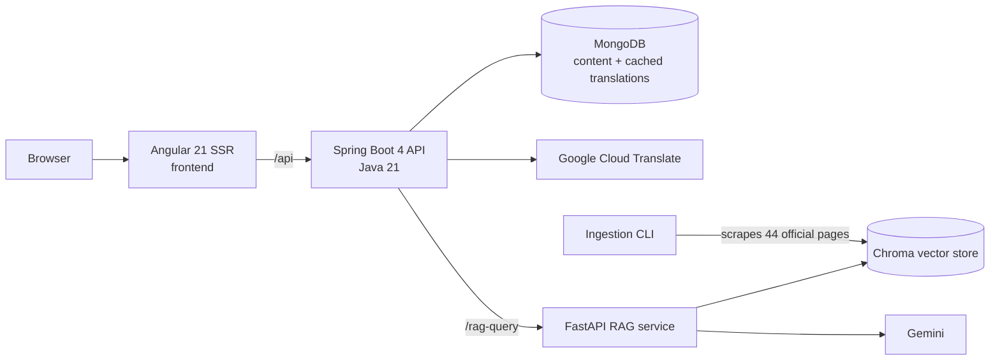

# HW Student Assistant

A multilingual onboarding portal for new Heriot-Watt University students, with an AI assistant
that answers questions from official university pages, **cites its sources**, and hands off to
the right support team when it doesn't know.

Built solo: all three services, the ingestion pipeline and the Docker setup.

Independent project, not affiliated with or endorsed by Heriot-Watt University.

<!-- Uncomment once the files exist in docs/:

-->

## Why

New students, especially international ones, face dozens of scattered university pages in their
first weeks: registration, visas, IT setup, GP registration, induction events. This portal brings
them into one place, in the student's own language (English, Spanish, French, German), with an
assistant that only answers from official sources and says so when it can't.

## Architecture



| Service | Stack | Responsibility |
|---|---|---|
| [`frontend/`](frontend/) | Angular 21 (SSR), Bootstrap, ngx-translate, Google Maps | Portal pages, chat widget, language switching, campus map |
| [`backend/`](backend/) | Spring Boot 4, Java 21, MongoDB, Google Cloud Translate | Content API, on-demand translation with hash-based cache invalidation, chat proxy |
| [`rag-service/`](rag-service/) | FastAPI, LangChain, Chroma, Gemini, all-MiniLM-L6-v2 (ONNX) | Retrieval-augmented answers with citations and conversation memory |

## Engineering decisions

- **Citations you can trust.** The LLM returns structured output (`answer` + `source_ids`). The
  service maps the IDs back to the documents it actually retrieved and drops any the model invents,
  so every link shown to the student is a page the answer was grounded in.
- **Grounded or handed off.** The assistant answers only from retrieved context. When the answer
  isn't there, it says so and routes the student to the right team's contact. Off-topic questions
  are declined, and messages showing emotional distress are escalated to the wellbeing team first.
- **Retrieval tuned for a small, departmental corpus.** A self-query retriever routes each question
  to a department (IT, wellbeing, international, ...) through metadata filters, and MMR keeps the
  four chunks diverse. Follow-ups such as "what about on my phone?" are rewritten into standalone
  queries, and translated to English, before retrieval.
- **Translations cached by content hash.** Content is written once in English. The first request in
  another language translates it and stores the result with a hash of the English source. Editing
  one section re-translates only that section; unchanged content is never re-translated.
- **Safe re-ingestion.** The vector store is rebuilt in a temporary directory and swapped in only
  when complete. Pages that fail to load abort the build (unless `--allow-partial` is passed) instead
  of silently shrinking the knowledge base.
- **Failures are visible.** If the RAG service is down, the API returns `503` with a standard error
  body and the chat shows a translated error. It never disguises an outage as an answer.
- **Embeddings without PyTorch.** The embedding model runs on ONNX Runtime instead of PyTorch. It cut the Docker images from about 3.9 GB to 2.0 GB.

## Quick start

Needs Docker and a free Gemini API key ([get one here](https://aistudio.google.com/apikey), no billing).

```bash
cp .env.example .env      # paste your Gemini key into GOOGLE_API_KEY
docker compose up --build
```

Open http://localhost:4200. The first build takes a few minutes.

- **Content:** MongoDB starts empty and the backend seeds it from
  [`backend/src/main/resources/seed/`](backend/src/main/resources/seed/) on first start.
- **Knowledge base:** the vector store is prebuilt and committed, so nothing is scraped at startup.
- **Languages:** the interface is fully translated. Page content is translated on demand if you add
  a `GOOGLE_TRANSLATE_KEY`; without one, it falls back to English.
- **Map:** the campus map needs a Google Maps key in `frontend/src/environments/environment.ts`
  (see [Development](#development)); without one, everything else works.

## Development

To run the services individually with live reload. Prerequisites: Java 21+, Node 22+, Python 3.12+
and MongoDB.

**1. RAG service** ([details](rag-service/README.md))

```bash
cd rag-service
python -m venv .venv && source .venv/bin/activate   # Windows: .venv\Scripts\activate
pip install -r requirements.txt
cp .env.example .env              # set GOOGLE_API_KEY (Gemini)
uvicorn app.main:app --port 8000
```

**2. Backend**

```bash
cd backend
./mvnw spring-boot:run             # http://localhost:8080
```

Connects to `mongodb://localhost:27017/portal` and seeds any empty collections. Optional env vars:
`MONGODB_URI`, `GOOGLE_TRANSLATE_KEY`, `RAG_SERVICE_URL` (default
`http://localhost:8000/rag-query`), `RAG_API_KEY` (must match the RAG service's `API_AUTH_KEY`
if that is set), `CORS_ALLOWED_ORIGINS`.

**3. Frontend** ([details](frontend/README.md))


```bash
cd frontend
npm ci
cp src/environments/environment.example.ts src/environments/environment.ts   # optional Maps key
npm start                          # http://localhost:4200, proxies /api to the backend
```

## Tests

260 automated tests: JUnit 112, pytest 57, Vitest 91. The LLM, vector store, Translate API and
network are faked, so every suite runs offline with no API keys.

From the repository root:

```bash
(cd backend && ./mvnw test)
(cd rag-service && pip install -r requirements-dev.txt && pytest)
(cd frontend && npm test -- --watch=false && npm run lint)
```

## Known limitations

- Chat history is held in memory by a single RAG instance and lost on restart. Redis would be
  needed to scale horizontally.
- No rate limiting on the RAG endpoint yet; it should sit behind a gateway that enforces one.

## Roadmap

- [x] One-command setup with Docker Compose and seed data
- [ ] CI on every push (GitHub Actions)
- [ ] Evaluation harness: golden question set, retrieval hit rate, citation precision, handoff accuracy
- [ ] Hosted demo
- [ ] Streaming responses
