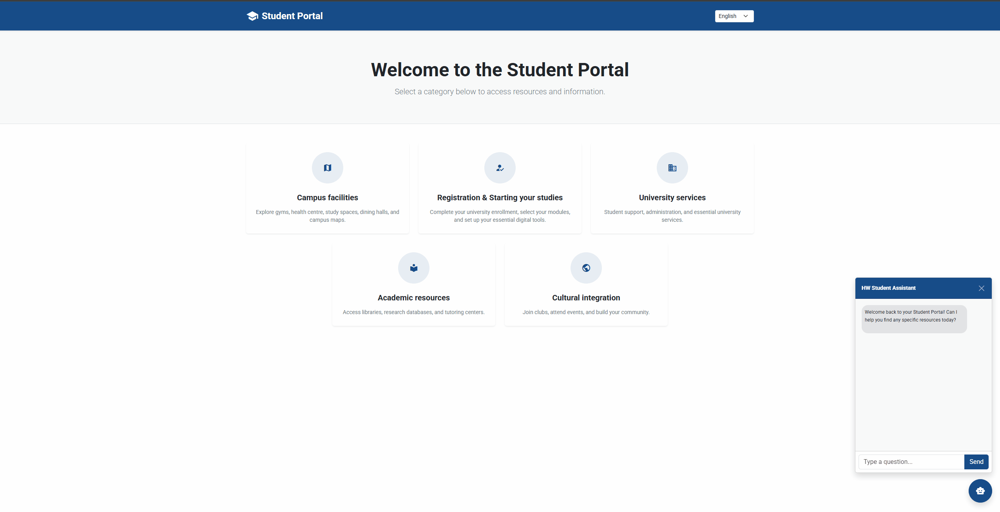
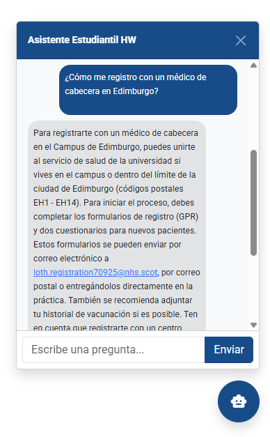
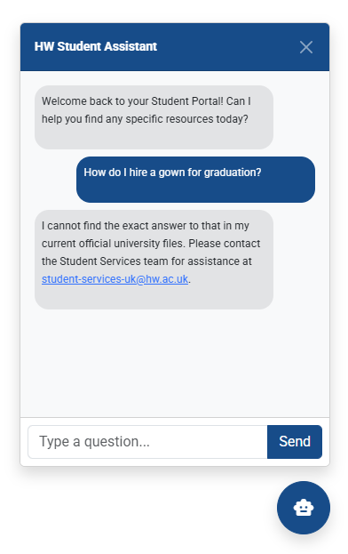
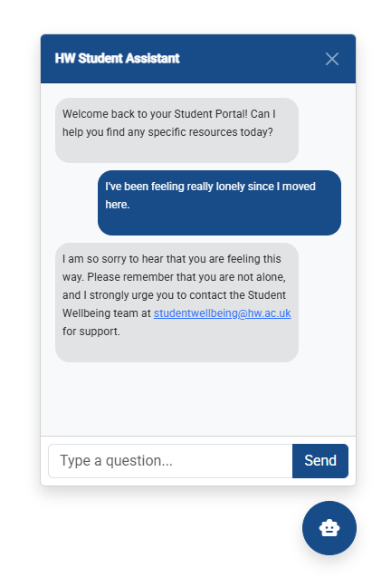
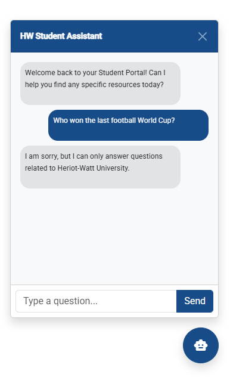
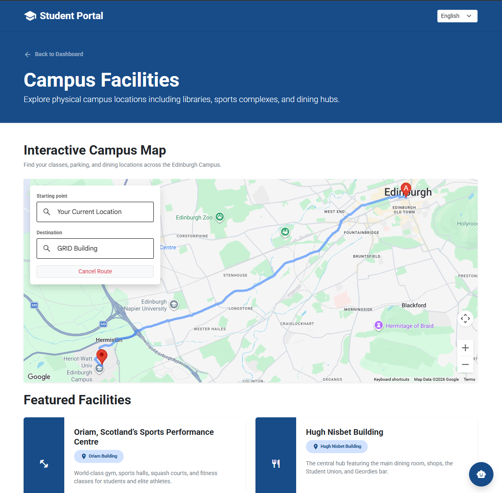
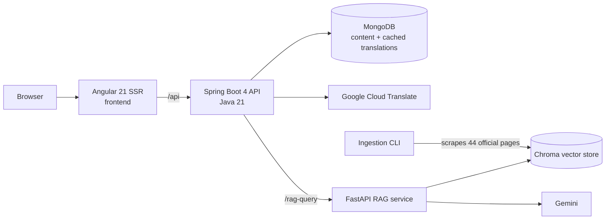

[](https://github.com/nastia-sydorchuk/student-assistant/actions/workflows/ci.yml)

# HW Student Assistant

A multilingual onboarding portal for new Heriot-Watt University students, with an AI assistant
that answers questions from official university pages, **cites its sources**, and hands off to
the right support team when it doesn't know.

Built solo: all three services, the ingestion pipeline and the Docker setup.

Independent project, not affiliated with or endorsed by Heriot-Watt University.


## Use cases

### 1. Browsing the portal in your own language

The whole portal switches language, here from English to French.



### 2. Asking in your own language

A question asked in Spanish is answered in Spanish.



### 3. Handing off when the answer isn't in the official pages

Instead of guessing, the assistant says it doesn't know and points to the right team.



### 4. Escalating distress to wellbeing

A student who says they feel lonely is pointed to the wellbeing team.



### 5. Declining off-topic questions

Questions unrelated to university life are politely declined.



### 6. Finding your way on campus

The campus map shows a walking route from the student's location to a building.



## Why

New students, especially international ones, face dozens of scattered university pages in their
first weeks: registration, visas, IT setup, GP registration, induction events. This portal brings
them into one place, in the student's own language (English, Spanish, French, German), with an
assistant that only answers from official sources and says so when it can't.

## Architecture



| Service | Stack | Responsibility |
|---|---|---|
| [`frontend/`](frontend/) | Angular 21 (SSR), Bootstrap, ngx-translate, Google Maps | Portal pages, chat widget, language switching, campus map |
| [`backend/`](backend/) | Spring Boot 4, Java 21, MongoDB, Google Cloud Translate | Content API, on-demand translation with hash-based cache invalidation, chat proxy |
| [`rag-service/`](rag-service/) | FastAPI, LangChain, Chroma, Gemini, all-MiniLM-L6-v2 (ONNX) | Retrieval-augmented answers with citations and conversation memory |

## Engineering decisions

- **Citations you can trust.** The LLM returns structured output (`answer` + `source_ids`). The
  service maps the IDs back to the documents it actually retrieved and drops any the model invents,
  so every link shown to the student is a page the answer was grounded in.
- **Grounded or handed off.** The assistant answers only from retrieved context. When the answer
  isn't there, it says so and routes the student to the right team's contact. Off-topic questions
  are declined, and messages showing emotional distress are escalated to the wellbeing team first.
- **Retrieval tuned for a small, departmental corpus.** One structured-output call turns each
  question into a standalone English search query and picks a department (IT, wellbeing,
  international, ...) to filter on, so follow-ups such as "what about on my phone?" and questions in
  other languages still find the right pages. The department is an enum built from the contact
  directory, so the model can't invent one. MMR keeps the four chunks diverse.
- **Translations cached by content hash.** Content is written once in English. The first request in
  another language translates it and stores the result with a hash of the English source. Editing
  one section re-translates only that section; unchanged content is never re-translated.
- **Safe re-ingestion.** The vector store is rebuilt in a temporary directory and swapped in only
  when complete. Pages that fail to load abort the build (unless `--allow-partial` is passed) instead
  of silently shrinking the knowledge base.
- **Failures are visible.** If the RAG service is down, the API returns `503` with a standard error
  body and the chat shows a translated error. It never disguises an outage as an answer.
- **Embeddings without PyTorch.** The embedding model runs on ONNX Runtime instead of PyTorch. It cut the Docker images from about 3.9 GB to 2.0 GB.

## Quick start

Needs Docker and a free Gemini API key ([get one here](https://aistudio.google.com/apikey), no billing).

```bash
cp .env.example .env      # paste your Gemini key into GOOGLE_API_KEY
docker compose up --build
```

Open http://localhost:4200. The first build takes a few minutes.

- **Content:** MongoDB starts empty and the backend seeds it from
  [`backend/src/main/resources/seed/`](backend/src/main/resources/seed/) on first start.
- **Knowledge base:** the vector store is prebuilt and committed, so nothing is scraped at startup.
- **Languages:** the interface is fully translated. Page content is translated on demand if you add
  a `GOOGLE_TRANSLATE_KEY`; without one, it falls back to English.
- **Map:** the campus map needs a Google Maps key in `frontend/src/environments/environment.ts`
  (see [Development](#development)); without one, everything else works.

## Development

To run the services individually with live reload. Prerequisites: Java 21+, Node 22+, Python 3.12+
and MongoDB.

**1. RAG service** ([details](rag-service/README.md))

```bash
cd rag-service
python -m venv .venv && source .venv/bin/activate   # Windows: .venv\Scripts\activate
pip install -r requirements.txt
cp .env.example .env              # set GOOGLE_API_KEY (Gemini)
uvicorn app.main:app --port 8000
```

**2. Backend**

```bash
cd backend
./mvnw spring-boot:run             # http://localhost:8080
```

Connects to `mongodb://localhost:27017/portal` and seeds any empty collections. Optional env vars:
`MONGODB_URI`, `GOOGLE_TRANSLATE_KEY`, `RAG_SERVICE_URL` (default
`http://localhost:8000/rag-query`), `RAG_API_KEY` (must match the RAG service's `API_AUTH_KEY`
if that is set), `CORS_ALLOWED_ORIGINS`.

**3. Frontend** ([details](frontend/README.md))

```bash
cd frontend
npm ci
cp src/environments/environment.example.ts src/environments/environment.ts   # optional Maps key
npm start                          # http://localhost:4200, proxies /api to the backend
```

## Tests

279 automated tests: JUnit 115, pytest 65, Vitest 99. The LLM, vector store, Translate API and
network are faked, so every suite runs offline with no API keys.

From the repository root:

```bash
(cd backend && ./mvnw test)
(cd rag-service && pip install -r requirements-dev.txt && pytest)
(cd frontend && npm test -- --watch=false && npm run lint)
```

A Playwright test also runs the chat through the real stack, with `FAKE_LLM=1` giving a canned answer
instead of calling Gemini. `GOOGLE_API_KEY` only has to be set, so any value works:

```bash
docker compose -f docker-compose.yml -f docker-compose.e2e.yml up -d --build --wait
(cd e2e && npm ci && npx playwright install chromium && npx playwright test)
docker compose down
```

## Trade-offs and what I'd change

- **Response time is set by the LLM.** Each question makes two sequential Gemini calls: one to plan
  the search, one to answer. Embedding and search take under a second, so almost all the wait is
  Gemini, and on a free-tier key that varies a lot from minute to minute. Merging the query rewrite
  and the department choice into one call cut a question from three calls to two. On a 7-question
  check, all seven answers stayed the same in substance and five retrieved exactly the same chunks.
  Next step: stream the answer, so the student sees it as it's written.
- **No evaluation set yet.** Answer quality has been checked by hand, not measured. A set of
  questions with the pages that should answer them would give retrieval hit rate, citation precision
  and handoff accuracy, and would show whether changes help. The first thing it would settle is the
  department filter: it fits a small corpus split by department, but nothing yet shows it beats plain
  vector search.
- **Chat history lives in memory.** It is simple and fast, but it limits the RAG service to one
  instance and is lost on restart. Redis would fix both.
- **No rate limiting.** Every question costs two LLM calls, so a public deployment would need a
  per-client limit, at the backend or a gateway.
- **Translation happens on first view.** The first visitor in each language waits for the Translate
  API. Translating whenever the English content changes would remove that wait.
- **The vector store is committed to git.** That makes setup a single command with no scraping, at
  the cost of binary files in the repository. Beyond a demo, it would be built in CI and stored
  outside the repository.
